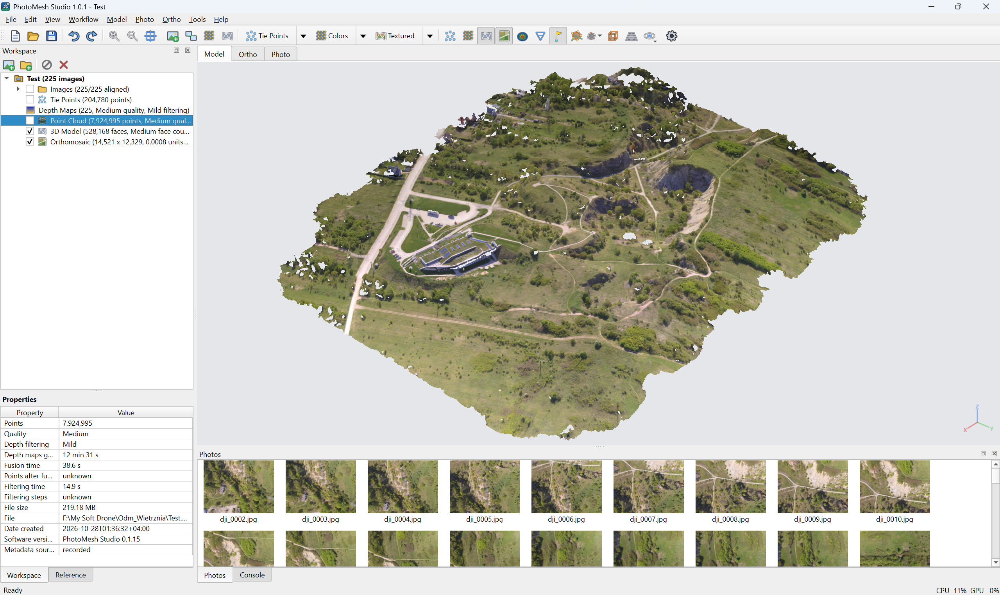

# Lens2Mesh

**Version 1.0.5 — test candidate.** New Lens2Mesh branding, reference/calibration controls, ground classification, LAS/LAZ, DTM and an interactive cross-section panel.

Lens2Mesh is a desktop photogrammetry application for processing aerial and terrestrial
imagery locally, without a cloud service. It is available at no charge for
personal and educational non-commercial use under the [project license](LICENSE).

Built with Python and PySide6, it uses COLMAP for photo alignment and dense
reconstruction, alongside application code for project management, visualization,
and surveying workflows.

**[Latest published Windows release: PhotoMesh Studio 1.0.4](https://github.com/behdad-nayyerpour/Desktop-PhotoMesh-Studio/releases/tag/v1.0.4)** ·
[User guide](docs/user-guide.md) · [Installation](docs/installation.md) ·
[Changelog](CHANGES.md) · [License](LICENSE) ·
[Report a problem](https://github.com/behdad-nayyerpour/Desktop-PhotoMesh-Studio/issues/new?template=bug_report.md)

## License

Personal projects, learning, non-commercial teaching and academic research are
permitted under the [PhotoMesh Studio license](LICENSE). Commercial use requires
prior written permission, including company evaluations, business workflows,
client projects and paid services. Contact the project owner through
[GitHub](https://github.com/behdad-nayyerpour) for separate permission.
Third-party components retain their respective licenses.

## Screenshots

The public Autzen LiDAR scene is open in Lens2Mesh1.0.5.
Both themes show the same automatic ground/non-ground classification from
10,653,336 points, with a bounded viewer preview. The Project panel is on the left;
the empty Photos panel is hidden for this LiDAR-only dataset.
These are actual application captures with Mesa OpenGL. See [image attribution and license](SCREENSHOT-LICENSE.txt).

**Dark theme**

**Light theme**

## Install

The currently published installer is `PhotoMeshStudio_Setup_1.0.4.exe` from
[Releases](https://github.com/behdad-nayyerpour/Desktop-PhotoMesh-Studio/releases/latest)
and run it. The offline installer includes Python, its required packages, COLMAP,
and optional legacy GLOMAP; a separate Python or Git installation is not needed.

The 1.0.5 candidate is tested using an exact-baseline BAT that downloads only
changed components, checks their hashes and retains rollback backups. Close the
application before using the supplied candidate updater. A complete
`Lens2Mesh_Setup_1.0.5.exe` will be built only after candidate acceptance.
Keep projects, processing results, and original photos outside the installation folder.
See [installation and requirements](docs/installation.md) and [updating](UPDATING.md).

## Main features

- Photo alignment with COLMAP, integrated global mapping, and legacy-engine fallback.
- Optional offline SIFT/LightGlue or ALIKED/LightGlue matching; SIFT remains the default.
- Dense point clouds, filtering, meshes, textures, and tiled 3D models.
- Ground control and check points, camera optimization, and error reports.
- Explicit coordinate/height references, optional GPS constraints and camera-model calibration.
- Ground/non-ground classification, class display, ground-only DTM and streaming LAS/LAZ.
- Survey > Cross Section in a bottom panel, live drawing and endpoint/midpoint editing.
- Orthomosaic and DEM generation with georeferenced raster export.
- Mesh contour export to DXF with `minor` and `major` layers.
- Import and export of survey shapes and common 3D formats.
- Local processing without a cloud service.

Dense reconstruction from depth maps requires an NVIDIA GPU and a compatible
CUDA build of COLMAP. Alignment and mesh generation from existing point clouds
can run on the CPU. The 3D viewer requires an OpenGL-capable driver.

## Quick start

1. Save a new project outside the application installation folder.
2. Choose **Project > Add Photos...** or **Add Photo Folder...**.
3. Run **Align Photos...**, then inspect the cameras and tie points.
4. Add ground control and optimize cameras when required.
5. Run **Build Point Cloud...**, **Build Mesh...**, and the required texture,
   DEM, or orthomosaic steps.
6. Use **Export** to save your deliverables.

For settings, marker editing, rebuilding after camera optimization, and contours,
see the [user guide](docs/user-guide.md).

## Documentation

| I want to... | Read |
|---|---|
| Install, check requirements, or move a project | [Installation](docs/installation.md) |
| Install a newer release | [Updating](UPDATING.md) |
| Process photos and export results | [User guide](docs/user-guide.md) |
| Diagnose a failed step | [Troubleshooting](docs/troubleshooting.md) |
| Run the source or contribute | [Development](docs/development/README.md) |
| Understand the processing pipeline and benchmarks | [Architecture and performance](docs/development/architecture.md) |
| Build the Windows installer | [Release guide](packaging/RELEASE.md) |
| Review changes by version | [Changelog](CHANGES.md) |

## Project

Lens2Mesh uses [COLMAP](https://colmap.github.io/) for reconstruction,
with the application's `fastpipe` orchestration pipeline and a Python/PySide6
interface using pyqtgraph.

Optional components include LightGlue and ALIKED for local feature matching,
and [GLOMAP](https://github.com/colmap/glomap) for compatible legacy workflows.
Third-party components retain their respective licenses.

Lens2Mesh is an independent project and is not affiliated with or endorsed
by Agisoft. See [project notes and third-party components](docs/development/project-notes.md)
for interface references and component information.
