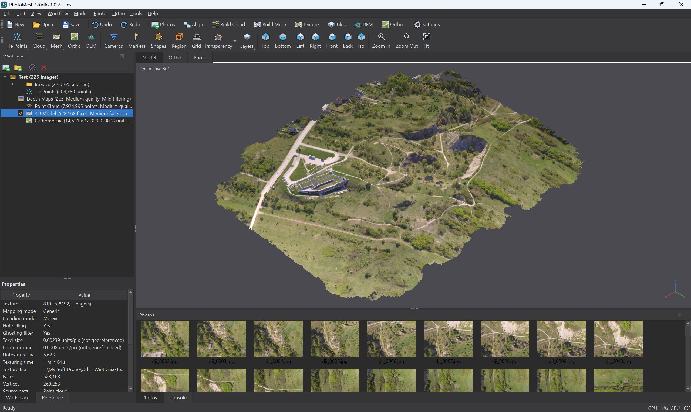

# PhotoMesh Studio

Desktop photogrammetry software for turning overlapping aerial photographs into
3D point clouds, textured meshes, orthomosaics, elevation models, and DXF contours.

**[Download for Windows](https://github.com/behdad-nayyerpour/photomesh-studio-improved/releases/latest)** ·
[User guide](docs/user-guide.md) · [Installation](docs/installation.md) ·
[Changelog](CHANGES.md) ·
[Report a problem](https://github.com/behdad-nayyerpour/photomesh-studio-improved/issues/new?template=bug_report.md)

## Install

Download `PhotoMeshStudio_Setup_<version>.exe` from
[Releases](https://github.com/behdad-nayyerpour/photomesh-studio-improved/releases/latest)
and run it. The offline installer includes Python, its required packages, COLMAP,
and GLOMAP; a separate Python or Git installation is not needed.

For a later version, close PhotoMesh Studio and run the newer Setup over the
existing installation. There is no separate Update EXE.
Keep projects, processing results, and original photos outside the installation folder.
See [installation and requirements](docs/installation.md) and [updating](UPDATING.md).

## Main features

- Photo alignment with COLMAP and optional GLOMAP acceleration.
- Dense point clouds, filtering, meshes, textures, and tiled 3D models.
- Ground control and check points, camera optimization, and error reports.
- Orthomosaic and DEM generation with georeferenced raster export.
- Mesh contour export to DXF with `minor` and `major` layers.
- Import and export of survey shapes and common 3D formats.
- Local processing without a cloud service.

Dense reconstruction from depth maps requires an NVIDIA GPU and a compatible
CUDA build of COLMAP. Alignment and mesh generation from existing point clouds
or tie points can run on the CPU. The 3D viewer requires an OpenGL-capable driver.

## Quick start

1. Save a new project outside the application installation folder.
2. Choose **Workflow > Add Photos...** or **Add Folder...**.
3. Run **Align Photos...**, then inspect the cameras and tie points.
4. Add ground control and optimize cameras when required.
5. Run **Build Point Cloud...**, **Build Model...**, and the required texture,
   DEM, or orthomosaic steps.
6. Use **File > Export** to save your deliverables.

For settings, marker editing, rebuilding after camera optimization, and contours,
see the [user guide](docs/user-guide.md).

## Documentation

| I want to... | Read |
|---|---|
| Install, check requirements, or move a project | [Installation](docs/installation.md) |
| Install a newer release | [Updating](UPDATING.md) |
| Process photos and export results | [User guide](docs/user-guide.md) |
| Diagnose a failed step | [Troubleshooting](docs/troubleshooting.md) |
| Run the source or contribute | [Development](docs/development/README.md) |
| Understand the processing pipeline and benchmarks | [Architecture and performance](docs/development/architecture.md) |
| Build the Windows installer | [Release guide](packaging/RELEASE.md) |
| Review changes by version | [Changelog](CHANGES.md) |

Historical engineering notes and portable-install instructions are kept in
[the documentation archive](docs/archive/README.md).

## Project

PhotoMesh Studio is built with Python, PySide6, and pyqtgraph. Reconstruction uses
[COLMAP](https://colmap.github.io/) and
[GLOMAP](https://github.com/colmap/glomap), with the project's own `fastpipe` pipeline.

The interface follows publicly documented photogrammetry workflows.
PhotoMesh Studio is an independent project and is not affiliated with Agisoft.
See [project notes and third-party components](docs/development/project-notes.md).
